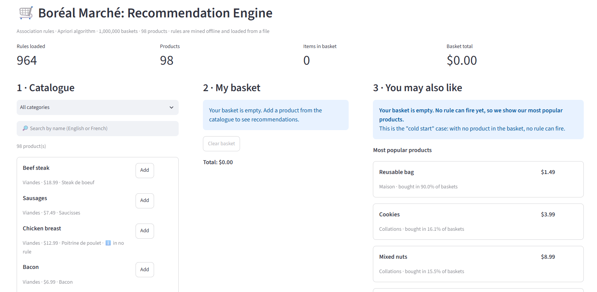
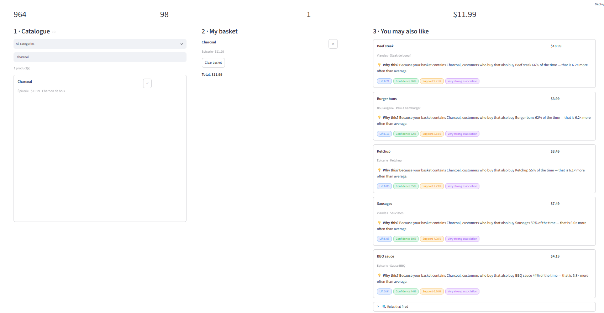
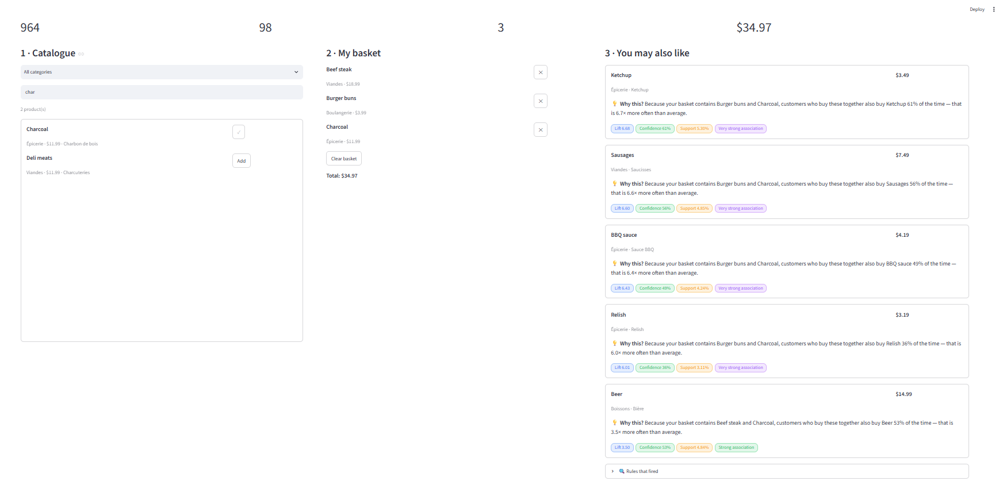
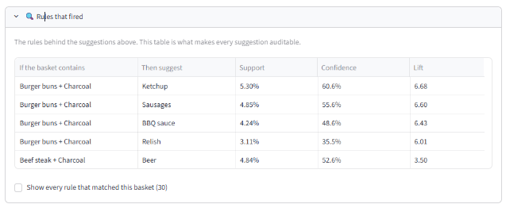
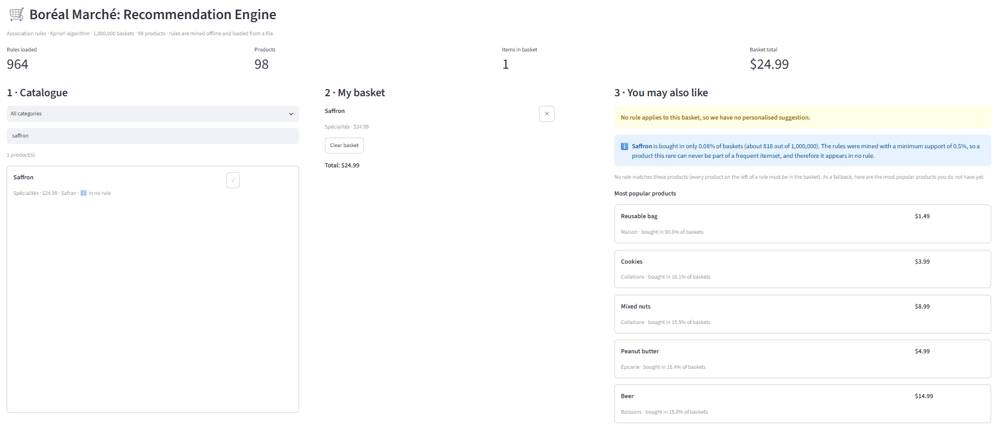

# Boréal Marché: a recommendation engine with association rules (Apriori)

Final project, 420-975-VA Unsupervised Learning, Vanier College. Individual work by **Carmen Chirila**.

**The question the system answers:** given what a customer has already put in the basket, what should we suggest next, and why?

From one year of transactions (1,000,000 baskets, 98 products) the notebook mines association rules with Apriori. A Streamlit application then uses those rules to suggest up to 5 products for a basket and explains each suggestion. The application never mines anything: it only loads a file.

## Results at a glance

| | |
|---|---|
| Data | 1,000,000 baskets, 8,379,837 rows, 98 products, 8.4 products per basket |
| Algorithm | `mlxtend.frequent_patterns.apriori` (only Apriori, as required) |
| Rules mined (whole year, min_support 0.005, confidence at least 0.30, itemsets of at most 4 products) | 13,892 |
| Rules in `models/rules.json` | **964** (lift above 1.1, one product on the right side, redundant rules removed) |
| Products the system can recommend | **57 of 98 (58%)** |
| Apriori with `low_memory=True` | about 410 MB and 3 to 30 s, whatever the `min_support` (the default mode needs about 13 GB from 0.02 down) |
| Biggest surprise | Reusable bag: in 90% of baskets, it makes 10 of the top 10 rules by confidence meaningless (see below) |

## Repository structure

```
boreal-reco-chirila-carmen/
├── README.md
├── requirements.txt
├── .gitignore
├── data/
│   ├── transactions.zip        1,000,000 baskets in long format (one row per product)
│   └── products.csv            98 products: Item (French), Item_EN, Category, Price
├── notebooks/
│   └── 01_mining.ipynb         executed, every output visible (Phases 1 to 6)
├── models/
│   ├── rules.json              rules mined offline, loaded by the application
│   └── metadata.json           thresholds, mining date, coverage, share of baskets per product
├── app/
│   ├── streamlit_app.py        the application
│   └── recommender.py          the engine (reads rules.json; no Apriori, no Streamlit)
├── tests/
│   └── test_edge_cases.py      the five edge cases of the brief, plus a few more tests
└── reports/
    ├── benchmark.md            timing and memory measurements, coverage, limitations
    └── screenshots/            images used below
```

`data/work/` (temporary files written by the notebook, a few hundred MB) is created when the notebook runs and is not in the repository (`.gitignore`).

## How to reproduce

1. Python 3.11 or newer. Install the packages with the exact versions I used:
   ```
   pip install -r requirements.txt
   ```
2. Open `notebooks/01_mining.ipynb` with the notebook folder as the working directory (the paths are `../data/...`) and run all cells from the top. This takes roughly 10 to 15 minutes on a computer with 8 GB of RAM (I did not time a full run). The only heavy step is the default-mode Apriori run at `min_support = 0.05`, which needs about 4 to 5 GB of free RAM. It creates `models/rules.json`, `models/metadata.json` and `requirements.txt`.
3. Start the application (a single command, it mines nothing):
   ```
   streamlit run app/streamlit_app.py
   ```
4. Run the tests:
   ```
   python tests/test_edge_cases.py
   ```

The notebook does not fail if `transactions.zip` has another name: it takes the first file called `transactions*.zip` in `data/`.

## What I did, phase by phase

**Phase 1: load and prepare.** The long file becomes a True/False table (1,000,000 × 98) with one numpy step and no loop: 16 s and 98 MB. Before mining anything, I wrote a prediction: the Reusable bag (in 90% of baskets, while the next product is at 16%) would flood the confidence ranking with rules ending in the bag, with a lift of about 1.
I looked for two products that are the same product recorded twice. The closest candidate was *Baguette* and *Pain baguette rustique*. They are bought together in 0.30% of baskets, which is exactly what chance predicts (0.29%), and their prices differ ($2.99 and $3.99). A search over all pairs of common products found no pair that is never bought together. I decided **not to merge** anything. Later results agree: Rustic baguette belongs to the raclette group (lift about 9.6 with Raclette cheese), while Baguette is never recommended.

**Phase 2: Apriori and its limits.** Four values of `min_support` (0.05, 0.02, 0.01, 0.005), each repeated 7 times, each in its own process. The default mode builds one block of True/False values of size baskets × candidate pairs, which needs about 13 GB from `min_support` 0.02 down, more than my 8.2 GB of RAM. `low_memory=True` checks the candidates one at a time and fixed the problem: about 410 MB whatever the threshold, and it was also much faster (3 s instead of 82 s at 0.05, with exactly the same 191 itemsets and 282 rules). Full numbers are in `reports/benchmark.md`. I did **not** see the actual `MemoryError`: running the default mode would have frozen my computer, so the notebook skipped those runs on purpose and I explain the failure with a calculation instead.

**Phase 3: evaluating the rules.** *Support* is the share of baskets that contain all the products of the rule. *Confidence* is, among the baskets that contain the left side, the share that also contain the right side. *Lift* is how many times more often the right side is bought with the left side than in general (1 means no link).

| Top 10 simple rules by confidence | Top 10 simple rules by lift |
|---|---|
| 10 of 10 end in the Reusable bag | 0 of 10 end in the Reusable bag |
| confidence 0.90, lift 1.00 | confidence 40% to 80%, lift 9.5 to 10.2 |
| nothing in common with the other list | raclette/fondue evening, sushi |

90% of baskets contain a bag, so about 90% of the baskets with *any* product contain one: "Cucumber → Reusable bag" tells us nothing. Lift divides by how common the right-side product is, so the same rule gets 1.003. My Phase 1 prediction was correct. One part was too strong: I expected the bag in almost every itemset, but it is in 44% of them. I keep only rules with lift above 1.1 (every rule with a lift between 1 and 1.1 has the bag on the right side, so the extra 0.1 removes only noise).

**Phase 4: seasons.** I mined June to August and December to February separately. Most simple rules are stable (median lift change 1.02 times), but the volumes change a lot: for example, Charcoal → Relish is in 9.2% of summer baskets and 1.2% of winter baskets, and Raclette cheese → Fondue broth is the other way around (6.7% in winter, 0.8% in summer). No rule disappears entirely: the 69 simple rules found in only one season still have a lift of at least 1.5 in the other season. They drop out of the mined list because their support or confidence falls under the thresholds. If the website used year-round rules in January, the numbers shown to customers would be wrong for many rules: for example "customers who buy Beer also buy Charcoal 45% of the time" when the real winter figure is 14%. Mining takes about 6 seconds per season, so I would re-mine at every change of season at the very least, and ideally every month, with one rule set per season.

**Phase 5: saving the rules.** `models/rules.json` keeps the rules with lift above 1.1 and one product on the right side. I also remove *redundant* rules: a product with no link to anything (Cookies, for example) can be added to the left side of a good rule without changing it ("Charcoal → Beef steak" and "Charcoal + Cookies → Beef steak" are nearly identical). Keeping both would let the application explain a suggestion with a product that has nothing to do with it. A rule with more products on the left is kept only if it beats every simpler version by at least 2 points of confidence.

From the 13,892 mined rules: 2,805 are removed because their lift is 1.1 or less, 4,368 because they have more than one product on the right side, and 5,755 because they are redundant. **964 rules are kept** (262 with one product on the left, 682 with two, 20 with three). Their lift goes from 2.1 to 14.6, with a median of 7.4.

**Phase 6: coverage and limits.** See below.

## The application

```
streamlit run app/streamlit_app.py
```

Three zones, as required:

1. **Catalogue:** all 98 products, filter by category, search by name (English or French, accents ignored), "Add" button.
2. **Basket:** the chosen products with category and price, a ✕ to remove one, "Clear basket", and the total.
3. **You may also like:** up to 5 suggestions, strongest lift first. Each card shows the product (name, category, price), a plain-language explanation ("Because your basket contains X, customers who buy that also buy Y N% of the time, that is L× more often than average"), the three metrics (support, confidence, lift), and a strength label. An expandable section **Rules that fired** shows the table of rules behind the suggestions, and a box lets you see every rule that matched the basket and why some of them are not displayed.

Strength label, from the lift: **weak** below 2, **moderate** from 2 to 3.5, **strong** from 3.5 to 5, **very strong** from 5. The sidebar shows the mining date and the thresholds.


*Empty basket: no rule can fire, so the application shows the most popular products (the "cold start" case).*


*One product in the basket (Charcoal): suggestions with the explanation and the three metrics.*


*Three products in the basket (Beef steak, Burger buns, Charcoal): five suggestions, each with its explanation and metrics.*


*The "Rules that fired" section, open: the exact rules behind the five suggestions. A box below the table lists all 30 rules that matched this basket and says why most of them are not shown.*


*A very rare product (Saffron) in the basket: the application explains why it appears in no rule.*

### The five edge cases (tested)

`python tests/test_edge_cases.py` runs one test for each case, on a small set of hand-made rules so that the result does not depend on the mined data.

| Situation | What the application does | Test |
|---|---|---|
| Empty basket | A clear message, then the most popular products | `test_1_empty_basket` |
| No rule fires | An explicit warning (never a blank panel), then the most popular products that are not already in the basket | `test_2_no_rule_fires` |
| Item already in the basket | Never suggested again | `test_3_item_already_in_basket_is_never_suggested` |
| Two rules suggest the same item | The rule with the higher lift is kept (both are visible in the audit table) | `test_4_two_rules_same_product_keep_higher_lift` |
| A very rare product | Explains why it is in no rule: for example Saffron is bought in only 0.08% of baskets (about 800), under the minimum support of 0.5% | `test_5_very_rare_product_is_explained` |

I also ran the application on these baskets, with the real `models/rules.json` (964 rules):

| Basket | What the application shows |
|---|---|
| Empty | The "your basket is empty" message, then the most popular products: Reusable bag (90.0% of baskets), Cookies (16.1%), Mixed nuts (15.5%), Peanut butter (15.4%), Beer (15.1%) |
| Saffron alone | Warning "No rule applies to this basket", the explanation that Saffron is in only 0.08% of baskets (about 818) and the minimum support is 0.5%, then the popular products |
| Carrots alone | Warning "No rule applies", and the explanation that Carrots is "bought often enough, but no rule that contains it passes the filters", then the popular products |
| Reusable bag alone | Warning "No rule applies", then the popular products (without the bag) |
| Charcoal | 5 suggestions: Beef steak 66% (lift 6.2), Burger buns 62% (6.2), Ketchup 55% (6.1), Sausages 50% (6.0), BBQ sauce 44% (5.8) |
| Charcoal + Beef steak | Neither Charcoal nor Beef steak is suggested back. The suggestions are Burger buns 68%, Ketchup 60%, Sausages 55%, BBQ sauce 49%, Relish 35% |
| Beef steak + Burger buns + Charcoal | 5 suggestions, for example Ketchup 61% (lift 6.7) and Beer 53% (lift 3.5). 30 rules match this basket, but only 5 products are suggested: for the same product, only the rule with the highest lift is shown (25 rules are marked "not shown: a rule with a higher lift suggests the same product") |
| Saffron + Charcoal | The 5 Charcoal suggestions, plus a note that Saffron is in no rule |
| Diapers | Baby wipes 67% (lift 9.5), Baby food 49% (8.8), Baby formula 36% (8.1), Beer 37% (2.4): only 4 suggestions, because no more rules apply |

Output of `python tests/test_edge_cases.py` (9 tests, run with the real `models/rules.json`):

```
PASS  test_1_empty_basket
PASS  test_2_no_rule_fires
PASS  test_3_item_already_in_basket_is_never_suggested
PASS  test_4_two_rules_same_product_keep_higher_lift
PASS  test_5_very_rare_product_is_explained
PASS  test_extra_explanation_sentence
PASS  test_extra_ranking_limit_and_subset_matching
PASS  test_extra_real_rules_file_if_present
PASS  test_extra_strength_labels

9 tests passed
```

## Ethical and legal framing

- **Law 25 (Québec).** A suggestion made only by an automated process has to be explainable. Each suggestion shows its explanation and its three metrics, and the **Rules that fired** table lists the exact rules behind it. This is also why year-round rules are a problem in January: the explanation would state a confidence that is not true for that season.
- **Correlation is not causation.** One of the rules reproduces the famous retail example of **Diapers and Beer**. In this data, Diapers are in 8.40% of baskets and Beer in 15.05%, and both are in 3.07% of baskets. Among the baskets with Diapers, 36.6% also contain Beer (against 15.05% in general): a lift of 2.43. The other way around, 20.4% of the baskets with Beer contain Diapers, with the same lift of 2.43 (lift is the same in both directions, confidence is not). `Diapers → Beer` is in `models/rules.json`, with 9 other rules that contain both products. A rule only says that two products are in the same baskets more often than chance. It does not say that buying diapers makes people buy beer, or the opposite. A third factor (for example the kind of shopping trip) can explain both, and the transactions cannot tell which. Using the rule to place beer next to diapers could work or not; the data alone does not prove it, only a test with customers would.
- **Reinforcement bias.** A system that only suggests what is already linked to the basket keeps selling the same products. The coverage measurement makes the risk visible: **only 57 of the 98 products (58%) can ever be suggested.** 41 never are: 5 are too rare to be in any rule (Saffron, Truffle oil, Caviar, Foie gras, Aged balsamic vinegar, each in about 800 baskets), and 36 are common but have no strong link with another product (for example Cookies, Cheddar cheese, Dish soap, Baguette, Carrots, and the Reusable bag, which is in 90% of baskets).

## Limitations (what does not work, and what I would add)

1. **Coverage.** 41 of the 98 products can never be recommended (see above). I would add a second recommender for them, for example "popular in the same category" or item-to-item similarity from customer histories, and measure the coverage again.
2. **No season and no customer.** One set of rules for everybody, all year. Phase 4 shows it is wrong in the off-season (in winter, 27% of the simple year-round rules state a confidence more than 20% away from the real winter value). The `CustomerID` column is not used. I would keep one rule set per season, re-mined automatically each month, and add a component that uses each customer's own history.
3. **Only one year of data.** I cannot tell whether the seasonal patterns come back every year or were one-time events.
4. **The thresholds shape the result.** With `min_support = 0.005` and itemsets of at most 4 products, a rule has at most 3 products on the left and any product under 0.5% of baskets is invisible. Other thresholds would give other rules.
5. **I never saw the `MemoryError`.** The default Apriori mode was not run below `min_support` 0.05 to protect my computer; the failure is explained by a calculation (`reports/benchmark.md`), not observed.
6. **Timings vary.** The same run can take 30 s or 222 s (observed at `min_support` 0.005), probably because other programs were open; I did not verify that.

## Honest notes: where I was wrong or surprised

- I predicted the Reusable bag would be in almost every itemset. It is in 44%.
- My first search for duplicate products returned only zeros. They were rare luxury products that share less than one basket by chance, so a zero meant nothing. I corrected it by only looking at pairs where at least 1,000 shared baskets were expected.
- I expected some rules to disappear completely from one season to the other. None does: seasonality shows up as a collapse in volume (about 8 times fewer baskets), not as a missing rule.
- A first test of year-round rules in January picked the 300 strongest rules, which are year-round habits (sushi), so it said nothing about seasonal rules. I replaced it with a test of every simple rule.
